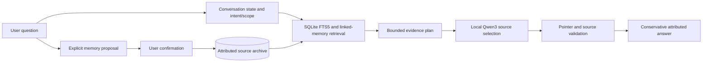

# Vera — local AI memory engine

Vera is a Python/SQLite research prototype for discussing attributed memories with
a local language model. It demonstrates persistent memory, contextual retrieval,
source provenance, explicit write confirmation and conversational evaluation.
Source records are authoritative; generated language is fallible.

This sanitized candidate is prepared for **private engineering review**, not
production deployment. All included people, memories and conversations are
synthetic. No project license has been selected.

## Architecture



- `vera/` contains the existing CLI, archive, retrieval and conversation engine.
  Earlier assistant summaries never become source evidence. Corrections retain
  original records; conversational writes require explicit confirmation.
- `experiments/` contains isolated model comparisons and request/context planning.
  These use a separate service/store and do not replace the CLI implementation.
- `research_snapshots/revision1/` preserves reviewed historical source as regular
  files; the root experiment is revision 2.
- `evidence/` contains clearly labeled, sanitized derivatives of saved results and
  independent agent reviews. It contains no raw wire transcripts or hidden model
  reasoning. Public and original-private hashes have different meanings.

The CLI's reference model is **`qwen3:4b`**. **GPT-OSS 20B is an experimental
candidate only**, not an approved CLI or production-model replacement. Literal
quotes, valid JSON and model-critic agreement do not prove semantic grounding.

## Installation

Use the repository root after cloning your eventual private repository or opening
this prepared directory. No remote repository is configured by these instructions.
The reference environment is **Python 3.14.4 with SQLite FTS5**. Runtime and tests
use the Python standard library; no pip dependencies are required.

POSIX shell / WSL:

```bash
python3 --version
python3 -m venv .venv
```

No `pip install -e .` is supported: this is a run-from-source project, not a packaged
wheel. See [runtime requirements](docs/RUNTIME_REQUIREMENTS.md) for platform limits.

## Synthetic demonstration

### Inspect memory without a model

These commands create only a local synthetic archive; they need no Ollama service:

```bash
.venv/bin/python -m vera --db data/demo.sqlite3 init
.venv/bin/python -m vera --db data/demo.sqlite3 seed-demo
.venv/bin/python -m vera --db data/demo.sqlite3 list
.venv/bin/python -m vera --db data/demo.sqlite3 show 2
```

Use a new path, not an archive containing personal records. Demo seeding skips
nonempty databases. A `photo_note` or `recording_note` is text describing a source,
not image recognition or speech processing. Database files are not encrypted.

### Converse using the reference local model

This is an optional **future manual step**, not part of regression tests or CI.
Install Ollama using its [official instructions](https://docs.ollama.com/quickstart).
The historical research runtime was Ollama 0.40.13; other versions need verification.
Start its local service only if it is not already running, then obtain the model:

```bash
ollama pull qwen3:4b
.venv/bin/python -m vera --db data/demo.sqlite3 --model qwen3:4b chat
```

Ollama must be reachable at `http://127.0.0.1:11434` in the CLI's network namespace.
Model downloads require internet access; the application sends inference only to
loopback. No cloud account, API key, cloud model or hosted vector database is needed.

Try this continuous sequence:

```text
Tell me about the Oregon coast trip.
What happened after they went crabbing?
Who remembers that?
Was the year certain?
```

The fixture describes an unsuccessful crabbing outing, purchased crab and Dad's
joke in Michael's recollection; other accounts have tentative/conflicting dates.
These are **source facts to inspect, not a newly verified model transcript or a
promise of exact replies**. Known relevance, scope and storytelling failures remain.
Use `/quit` to end the chat. In a synthetic chat, `/remember` proposes a JSON record;
`/confirm` commits the pending change and `/cancel` discards it. Do not add personal
material to tests, commits, issues or CI artifacts.

## Model-independent regression tests

The existing root suite tests SQLite integrity, retrieval, source validation,
confirmation/correction/deletion, conversation regressions and response parsing.
Model responses, GPU/host probes and service operations are mocked where needed.
It does not run the saved conversational evaluations or require models, a GPU,
PowerShell or an Ollama installation.

From the root, run exactly one invocation when intentionally validating changes:

```bash
.venv/bin/python -B scripts/run_unit_tests.py
```

The test-only runner blocks live network connections and child processes, keeps
synthetic temporary data in ignored `.test-tmp/`, and fails if a live I/O attempt
occurs even if a test catches the exception. It does not alter application behavior.
See [testing and verification](docs/TESTING.md) for the recorded local result.
Local candidate verification: **122 tests passed, with zero failures, errors or
skips**, in exactly one guarded run (3.368 seconds). No live-I/O attempts were
recorded. See [the current result](evidence/verification/local-regression-result.json)
and [sanitized log](evidence/verification/local-regression-tests.txt).
The older 122-pass result in `evidence/prior-test-status.json` remains historical.

[The GitHub Actions workflow](.github/workflows/tests.yml) uses the same runner on
Ubuntu 24.04 / Python 3.14.4, with SHA-pinned actions and read-only permissions.
It neither installs Ollama nor downloads models. Hosted checkout/Python provisioning
uses GitHub networking before the guarded tests. No GitHub job has run locally.

## Research findings and limitations

Saved results show why retrieval coverage is insufficient: answers can quote real
sources yet miss the requested detail, include excluded material or lose qualifiers.
The revision-2 source planner respected all five tested explicit exclusions but
completed only 9/16 questions versus 10/16 for its same-round baseline. Unreleased
natural drafts had unsupported claims in 8/16 answers. A boundary challenge retained
critical spans in 8/8 cases but fully answered only five. These are small, correlated,
agent-reviewed samples, not independent human validation or universal accuracy.

Known limitations include heuristic retrieval/segmentation, missing actor/date
qualifiers, unnecessary clarification, incomplete unknown answers and unnatural
excerpt composition. Generated prose can invent intent, identity or chronology.
No zero-hallucination, production-readiness or model-switch claim is made.

Read [saved research findings](docs/RESEARCH_RESULTS.md),
[reproduction boundaries](docs/REPRODUCIBILITY.md), [data provenance](docs/DATA_PROVENANCE.md)
and [publication provenance](docs/PUBLICATION_PROVENANCE.md). Live research monitors
are currently tied to a Linux/WSL2 + Windows + NVIDIA profile. They are not part of CI.
No voice, hardware control, cloud synchronization or remote messaging is implemented.

## Licensing and review status

[Third-party notices](THIRD_PARTY_NOTICES.md) identify separately installed runtimes,
CI actions and optional models. They do not license this project's code or data.
There is intentionally no project `LICENSE`; see [licensing status](docs/LICENSING_STATUS.md).
Owner approval and final publication/data review remain required. Nothing is pushed
or published automatically.
